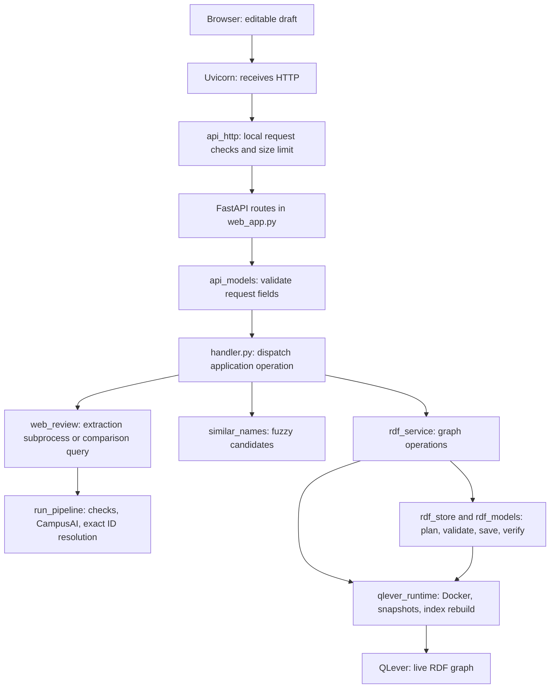

# Understanding the Anywikia backend

This guide describes the FastAPI implementation. Start here to learn the code;
use [how-to-run.md](how-to-run.md) for installation and startup commands.
The program still uses Python. FastAPI replaces the old built-in HTTP server,
not the extraction or RDF algorithms. Vector search is not implemented.

## 1. The main idea

Anywikia extracts musical-keyboard facts from text, helps a person identify the
right database entity, and saves only explicitly confirmed changes.



An HTTP request is a message from the browser. An endpoint is the URL and method
that receives it. A JSON request body carries the input fields. The endpoint
returns JSON that the frontend displays. GET reads information; this application
also uses POST for some reads with structured inputs, so POST alone does not
mean that RDF is being changed.

A QID identifies an entity, such as a keyboard or manufacturer. A PID identifies
a property: P1 is keys, P2 is width. RDF represents facts as subject/predicate/value
triples. SPARQL is the language used to query or update those triples. An index
is QLever's optimized representation of RDF for answering queries.

## 2. Which file owns which responsibility?

| File | Responsibility |
| --- | --- |
| `web_app.py` | Creates FastAPI, names routes, serves allowed frontend files, and starts Uvicorn. Its short adapter functions call the central handler. |
| `api_models.py` | Describes HTTP inputs, field lengths and ID syntax. Strict boolean fields prevent text such as `"true"` from acting as approval. |
| `api_http.py` | Checks hosts, origins, tokens and body size; converts expected exceptions to browser-readable errors. |
| `handler.py` | Coordinates the pipeline, read-only review actions and graph actions. Also provides the CLI. |
| `functions/web_review.py` | Runs extraction in a child process and queries stored direct values for comparison. |
| `functions/ocr.py` | Converts PDF pages to images, transcribes each image and joins numbered text; shared by CLI and `/ocr`. |
| `functions/extract_input.py` | Builds the extraction prompt and calls CampusAI using the OpenAI-compatible client. |
| `functions/pydantic_models.py` | Defines extracted keyboards and quantity/entity/text claims, plus fixed property mappings. |
| `functions/resolve_local.py` | Looks up exact labels/aliases and attaches local IDs without replacing source facts. |
| `functions/resolved_models.py` | Defines the grouped output: keyboards, properties, claims, IDs, candidates and warnings. |
| `functions/similar_names.py` | Loads keyboard names/aliases, caches them briefly and ranks spelling matches. |
| `functions/rdf_service.py` | Connects graph operations to the store/runtime; owns background rebuild progress. |
| `functions/rdf_models.py` | Validates reviewed writes against property types, allowed units and entity rules. |
| `functions/rdf_store.py` | Reads statements, plans exact changes, commits approved previews and verifies results. |
| `functions/qlever_runtime.py` | Runs Docker commands, communicates with QLever and manages persistent index generations. |
| `functions/qlever_ui.py` | Starts the optional separate SPARQL query editor. |
| `functions/qlever_checks.py` | Checks query execution and the intended dataset before extraction. |
| `functions/entity_catalog.py` | Chooses readable display names; it no longer exports an entity JSON catalog. |
| `functions/progress.py`, `display_results.py` | Terminal progress and CLI output. |
| `local_rdf.py` | Shared repository paths and the QLever endpoint. |

`create_app()` builds routes and a CSRF token without starting Docker or making
an LLM request. `main()` preserves `python web_app.py --port 8000`. `app` is the
module-level ASGI application that Uvicorn can import. ASGI is the interface
between the HTTP server and the Python web application.

## 3. Libraries and services

| Technology | Why it is present |
| --- | --- |
| Python | Backend application language; Python 3.13 is the documented target. |
| FastAPI | Matches routes, validates request models and generates OpenAPI documentation. |
| Uvicorn | Listens on localhost and runs the FastAPI ASGI app. |
| Starlette / AnyIO | Web responses, middleware support, test client and concurrency support underneath FastAPI. |
| Pydantic | Validates extraction data and reviewed-write inputs. Structural validity does not establish factual truth. |
| OpenAI Python SDK | Talks to the configured CampusAI compatible endpoint; this is not necessarily an OpenAI-hosted model. |
| HTTPX | Sends SPARQL HTTP requests; also supports HTTP testing. |
| RDFLib | Represents graphs and RDF terms, constructs changes and checks graph equivalence. Offline tests execute SPARQL with RDFLib. |
| python-dotenv | Loads CampusAI settings from the private `.env` file. |
| Docker and QLever | Run the persistent graph server and build query indexes. Python calls the Docker CLI. |
| qlever Python package | Included CLI/tooling dependency for the QLever workflow; managed lifecycle code itself uses Docker commands. |
| requests | HTTP dependency retained for QLever tooling; the application query-UI helper uses HTTPX. |
| PyYAML | Reads/writes configuration for the managed query UI; installed through QLever's dependencies. |
| Standard library | `subprocess` isolates extraction and runs commands; `threading` manages progress/jobs; `secrets` creates tokens; `pathlib` handles files. |
| HTML/CSS/plain JavaScript | Browser UI, with no frontend build step. Node runs JavaScript tests. Playwright is optional for the browser smoke test. |

`requirements.txt` lists direct dependencies and allowed ranges. The lock file
pins the full resolved dependency set, including indirect packages. The FastAPI
migration preserves the existing package pins and adds its required packages.

Official references: [FastAPI](https://fastapi.tiangolo.com/),
[Uvicorn](https://www.uvicorn.org/), [Pydantic](https://docs.pydantic.dev/),
[HTTPX](https://www.python-httpx.org/), [RDFLib](https://rdflib.readthedocs.io/).

## 4. HTTP call reference

All paths below are relative to `http://localhost:8000`. POST bodies use
`Content-Type: application/json`, except `/ocr`, which uses multipart form data. Every `/api/graph/*` POST and `/ocr` also needs
`X-Anywikia-CSRF`, copied from the `csrf` field in GET `/api/graph/status`.
This token is a local browser-request protection, not user authentication.

| Method and path | Input | Calls / purpose | Output and side effects |
| --- | --- | --- | --- |
| GET `/` | None | `home()` | Serves `frontend/index.html`. |
| GET `/app.js`, `/comparison.js`, `/review-plan.js`, `/rdf-review.js`, `/style.css` | None | Explicit asset routes | Serves only these allowed files. |
| GET `/api/graph/status` | None | `graph_action("status")` → `rdf_service.status()` | `ready`, `message`, `endpoint`, `properties`, `rebuild`, `csrf`. Does not start QLever. |
| POST `/ocr` | Multipart field `file`: PDF, PNG, JPEG or WebP, up to 20 MB | `ocr_endpoint()` → `transcribe_document()` | `text`: complete numbered transcription. Calls CampusAI once per page; removes temporary upload. No RDF writes. |
| POST `/api/extract` | `text`, 1–20,000 characters, not whitespace-only | `extract()` → `review_action("extract")`; then `add_name_suggestions()` | Grouped entities and warnings, optionally `name_suggestions` or `suggestion_error`. Calls CampusAI; no RDF writes. |
| GET `/api/entities/{qid}` | QID in URL | `inspect_entity()` → `review_action("inspect")` | `id` and raw SPARQL property bindings for comparison. Read-only. |
| POST `/api/graph/inspect` | `entity_id` | `graph_action("inspect")` → `store.inspect()` | `id`, `name`, `statements`, including statement identities and replaceability. Targeted RDF query. |
| POST `/api/graph/search` | `text`, 1–250 characters | `graph_action("search")` → `store.search()` | `matches` with QIDs and names, up to 30. This is label/alias/QID search for entity-valued fields, not fuzzy keyboard suggestion. Currently reads a full snapshot. |
| POST `/api/graph/preview` | Reviewed write, described below | `preview_change()` → `store.preview()` → `build_change()` | `preview_id`, `entity_id`, `summary`, `new_entity`, `expires_in_seconds`. Saves a plan on disk, not live RDF. |
| POST `/api/graph/confirm` | `preview_id` and `confirmed: true` | `confirm_change()` → `store.commit()` | Operation/entity IDs, status and verification information. Applies or checks the original RDF operation. Invalidates fuzzy-name cache. |
| POST `/api/graph/verify` | `entity_id`; optional `property_id` (null/empty means all supported properties) | `verify_graph()` → `store.verify_query()` | Generated SPARQL `query` and SPARQL `results`. Read-only. |
| POST `/api/graph/rebuild` | `confirmed: true` | `rebuild_graph()` → background `runtime.rebuild()` | Current job status/message. Poll status to learn completion/failure; the initial response does not mean rebuild completed. |

The command-line `setup` and `query-ui` handler actions remain CLI operations;
they are not new public HTTP endpoints.

### Preview request example

This is an illustrative existing-entity edit. Q123 must actually exist and its
reviewed name must agree with the graph. A real replacement uses the statement
URI returned by `/api/graph/inspect`, not an invented identifier.

```json
{
  "mode": "existing",
  "confirmed": true,
  "target_id": "Q123",
  "name": "Yamaha P-150",
  "source": "The Yamaha P-150 has a width of 1385 mm.",
  "aliases": [],
  "claims": [{
    "property_id": "P2",
    "value": "1385",
    "unit": "mm",
    "action": "add",
    "evidence": "The Yamaha P-150 has a width of 1385 mm."
  }]
}
```

- `mode` is `existing` or `new`. A new entity uses a null/omitted `target_id`.
- `confirmed` means the person has confirmed the identity/new-entity choice.
- `claims` contains 1–100 selected edits. `value` is a string, even for numbers.
- `action` is `add` or `replace`; replace requires the exact `statement` URI.
- Entity-valued edits use `value_id` and `value_confirmed`, or an explicitly
  selected `create_value_entity` with a name. The RDF service checks these rules.
- `manual` identifies a manually entered/edited claim. `evidence` and `source`
  become reference metadata; they do not automatically prove the claim.
- The schema at `/docs` lists every field, default and length restriction.

After reviewing the returned summary, the browser sends a second request:

```json
{"preview_id": "<the exact returned preview_id>", "confirmed": true}
```

That second request goes to `/api/graph/confirm`. A preview ID is 32 hexadecimal
characters. Do not generate a new ID to retry an uncertain save.

## 5. Walk through extraction and matching

1. The Extract button in `frontend/app.js` sends the text to `/api/extract`.
2. `LocalRequestMiddleware` checks the request before JSON parsing. Pydantic then
   validates `ExtractionRequest`, and FastAPI calls `extract_endpoint()`.
3. The endpoint calls the read-only adapter. `web_review.extract()` starts a
   child Python process with the same interpreter, sends text on stdin, captures
   JSON on stdout and leaves progress on stderr. It enforces a 300-second timeout.
4. The child calls `handler.run_pipeline()`: `check_server()`, `check_dataset()`,
   `extract_entities()`, Pydantic validation, then `resolve_extraction()`.
5. CampusAI produces grouped facts. Width is a decimal amount plus source unit;
   manufacturer is a name. Missing properties remain empty lists. Conflicting
   claims remain separate. The application supplies PIDs, not the model.
6. `search_local()` searches exact labels and aliases. One match supplies an ID;
   zero/multiple matches remain unresolved with warnings. A lookup failure after
   preflight preserves the extracted fact rather than deleting it.
7. Back in the website process, `add_name_suggestions()` considers only keyboards
   with no exact local match. Exact ambiguity and query failures do not trigger it.
8. `load_names()` queries keyboard labels/aliases, not the whole RDF graph.
   `cached_names()` holds them for five minutes, refreshed lazily. `suggest_names()`
   normalizes case/whitespace and ranks Levenshtein spelling distance below three.
   It returns up to three distinct QIDs, using each entity's best matching alias.
9. The browser keeps `original` and a separate `structuredClone` called `draft`.
   Editing that draft changes browser memory only. Suggestions never authorize a save.

## 6. Walk through review, replacement and new entities

`app.js` handles identity confirmation and rendering. `comparison.js` compares
source claims with stored values. Comparisons require a confirmed identity and
do not convert units. `review-plan.js` chooses add/replace and groups conflicting
extracted alternatives for an explicit choice.

`rdf-review.js` collects selected edits using `writePayload()`. For existing
entities it reads current statements first. One replaceable stored statement can
be selected automatically; multiple statements require a choice or an explicit
add. The backend checks the selected statement belongs to the right entity/property.

`RDFStore.preview()` locks writers, reads a graph snapshot and validates the
request. `build_change()` copies the graph and constructs the proposed update.
`value_terms()` checks property definitions, numbers, units and references.
`next_ids()` proposes unused QIDs from graph contents for new entities, including
explicitly created value entities and price offers. No new entity is live yet.

`add_statement()` builds direct values and full statements with quantity metadata,
source/evidence references and operation IDs. Prices live on offers linked to
keyboards through P24; P25 stores the offer price. The store calculates exact
added/deleted triples and saves a preview with its graph revision and timestamp.

After the second confirmation, `commit()` checks the stored plan, operation marker,
15-minute expiry and current graph revision under the writer lock. It sends
SPARQL DELETE/INSERT through `runtime.update()` and reads back the graph. A repeated
confirmation checks the operation marker instead of duplicating the write.
Results distinguish verified writes, recorded writes with verification differences,
and uncertain outcomes. The UI retains the original pending save for safe retries.

## 7. Exporting RDF and switching indexes

Confirmed saves update the live graph and persistent update log immediately.
They do not rewrite `keyboards-index/keyboards.nt` on every edit.

`rebuild_graph()` starts one background thread and records progress. Its call to
`QLeverRuntime.rebuild()` locks writes, exports a snapshot, builds a staged index,
starts a temporary QLever server and checks graph equivalence. It preserves the
previous generation/source, switches the main server, verifies again, then
publishes the source file and active-generation pointer. Failures trigger rollback;
setup can recover an interrupted switch. Queries can pause briefly during switching.

| State | Owner | Durable? |
| --- | --- | --- |
| Original extraction and draft | Browser memory | No; export review JSON to keep a copy. Import is not implemented. |
| Name suggestion cache | Website process | No; can be regenerated. |
| Previews, operation records, runtime configuration | `.anywikia/` | Yes; private and ignored by Git. |
| Live saved RDF | QLever index plus persistent update log | Yes; retain runtime storage. |
| Exported RDF | `keyboards-index/keyboards.nt` | Updated on successful export/rebuild; suitable for requested Git commits. |

No automatic Git commit/push occurs. QLever switching is a switch of indexes
built from RDF, not a browser draft becoming a database file directly.

## 8. Concurrency, errors and local access

Routes that call blocking Python code use ordinary `def`; FastAPI runs them in a
thread pool. Middleware uses `async def` to receive HTTP body messages. The
extraction child and rebuild thread keep their existing lifecycles. FastAPI does
not make LLM inference or index construction faster.

Use one Uvicorn worker: the CSRF token, rebuild job state and name cache are
process-local. Existing writer locks still guard graph changes across threads and
processes, but they do not make the other state suitable for multiple web workers.
Do not enable reload during saves/rebuilds. Keep graph startup explicit rather than
starting Docker whenever an app is imported or an HTTP worker restarts.

Requests must address localhost/127.0.0.1 on the actual serving port. POST origins,
when supplied, must match. Graph POSTs require the current token. Body bytes are
counted up to 500,000 for JSON requests, including chunked requests, before parsing.
The `/ocr` multipart limit is 20 MB plus 64 KiB overhead. Static
routes expose an allowlist, not the repository directory. Responses carry no-store
and nosniff headers. This remains a local, single-user app, not an authenticated
public service. CORS is not enabled and the launcher ignores proxy headers.

| HTTP status | Meaning |
| --- | --- |
| 400 | Invalid JSON, body size, request field, ID, unit, or domain operation. |
| 403 | Host/origin/token rejected. Reload after a server restart to obtain a fresh token. |
| 404 / 405 | Unknown path / unsupported HTTP method. |
| 502 | Backend HTTP request failed, such as an unreachable QLever endpoint. |
| 503 | Runtime unavailable or a save outcome needs checking. Read the message. |
| 504 | Extraction exceeded the five-minute subprocess timeout. |

Expected failures return `{"error": "readable message"}`. Request-validation
messages include field names without echoing the source payload. Unexpected
programming errors are server errors and require terminal logs; they are not
reported as successful saves.

## 9. Exploring and testing the API

With the app running, visit `/docs` for the generated interface or `/openapi.json`
for its machine-readable schema. In `/docs`, first execute GET graph status, copy
`csrf`, and paste it into **Authorize**. Graph actions still require their separate
`confirmed` fields. Executing a confirm/rebuild here has the same real effects as
using the website. Swagger's interface assets are normally fetched from a CDN;
the application frontend and raw OpenAPI JSON are local.

Read the code in this order: `handler.run_pipeline`, extraction/resolution modules,
`web_app.create_app`, frontend draft handlers, `RDFStore.preview/commit`, then
`QLeverRuntime.rebuild`. Tests are optional examples, not extra pipeline stages.

`test_graph_http.py` uses FastAPI TestClient to check real routing, request models,
middleware and errors without live services. Other Python tests cover extraction,
RDF construction and mocked lifecycle operations. The disposable browser fixture
uses real FastAPI/Uvicorn with in-memory RDF and fake extraction. These checks do
not establish live CampusAI output quality or Docker/QLever rebuild compatibility.
See [how-to-run.md](how-to-run.md) for test commands and [limitations.md](limitations.md)
for the remaining operational limits.


## File input: the OCR endpoint

The input flow is deliberately two simple API calls:

```text
Typed text --------------------------------> POST /api/extract
PDF/image -> POST /ocr -> {text} -----------> POST /api/extract
                                              |
                                     matching and review draft
```

`web_app.ocr_endpoint(file: UploadFile)` accepts one multipart upload. FastAPI
uses `python-multipart` to parse that request. The endpoint checks its extension
and size, copies it to a temporary file with a fixed name, and calls the existing
`transcribe_document(path)`. A temporary directory is used only to bridge the
upload to this file-path function; the OCR implementation itself stays simple.
The directory is removed whether transcription succeeds or raises an error.

For PDFs, `pdf2image.convert_from_path` produces Pillow images. For an image input,
Pillow opens one image. The same page loop sends each image to CampusAI, logs
completion and combines strings with page numbers. Rendering all pages at once
uses memory proportional to document size. OCR is called in a synchronous FastAPI
route, which runs in the thread pool; per-page logs are not streamed to the browser.

`frontend/app.js` has one `startExtraction(file = null)` function. File-picker and
drop events both call it. It uses `FormData` to upload the file without manually
setting Content-Type (the browser must supply the multipart boundary). It gets
the current CSRF token from graph status, calls `/ocr`, fills the text box, then
uses the unchanged JSON `/api/extract` call. Text input skips the OCR step.

`api_http.py` permits multipart only for `/ocr`, requires its CSRF token and
checks local host/origin as before. Upload bodies allow 20 MB plus 64 KiB for
multipart overhead; the endpoint checks that the actual file is no more than
20 MB. Other POSTs retain the 500,000-byte JSON limit. Missing Poppler returns 503,
invalid files 400, CampusAI failures 502 and OCR timeouts 504, all as `{error}`.

The frontend retains the entire OCR text if it exceeds the extraction endpoint's
20,000-character limit. It pauses with an explanation rather than truncating or
splitting facts automatically. The user can shorten it and submit text normally.
No matching, review or RDF-save code is duplicated or exposed as extra endpoints
in this change. Internal helper functions remain ordinary Python calls.
