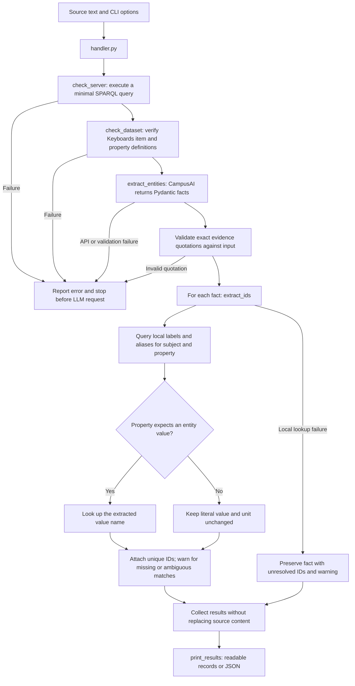

# Current Anywikia workflow

Run `python tests/start_qlever.py` before `python handler.py "Source text"`.
The diagram describes implemented behavior, not the future population workflow.

The local graph supplies matching IDs, not fact values. Exact quotation presence
does not prove semantic support. This pipeline does not compare existing values,
approve claims, or modify RDF. The two server checks are in
`functions/qlever_checks.py`; every step module can also be executed independently.
