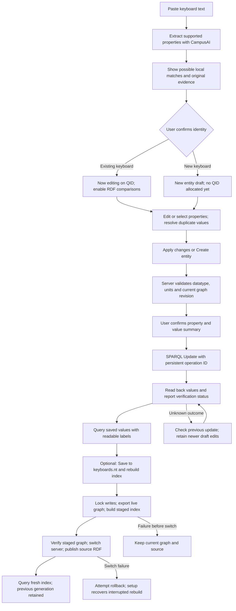
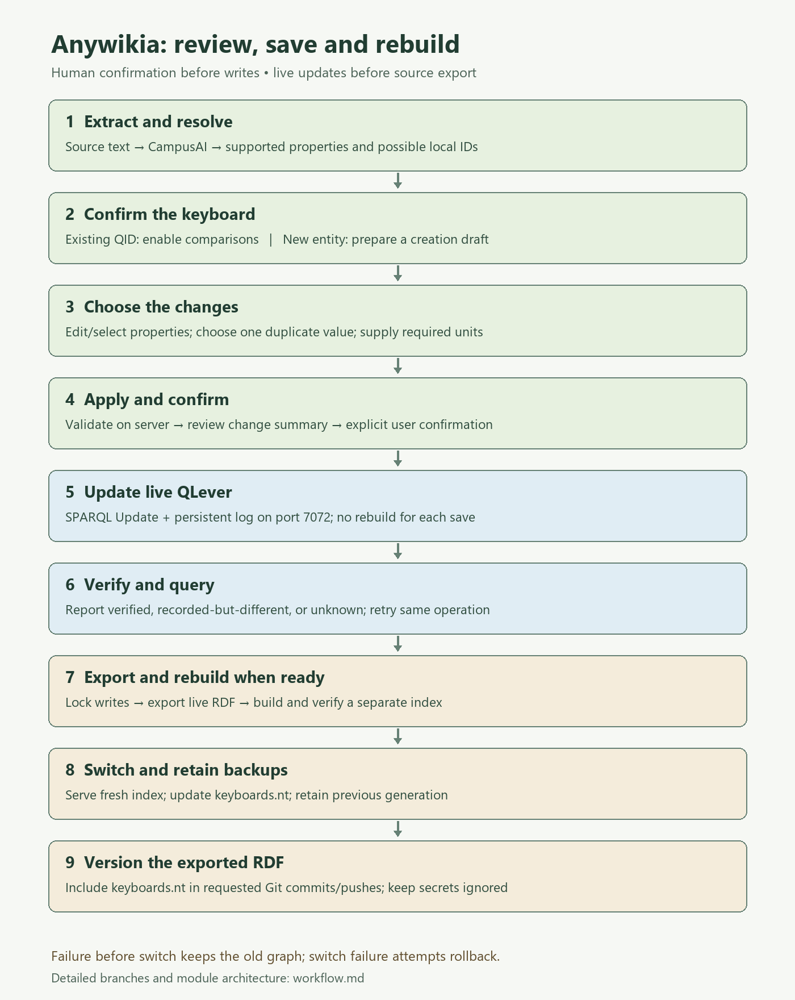
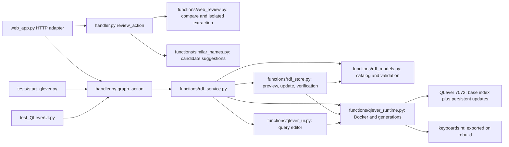
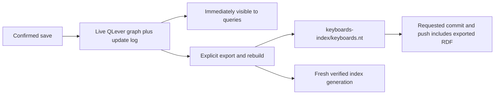

# Implemented workflow

The source diagrams below describe the current application. Original project
proposals are historical plans. See [how-to-run.md](how-to-run.md) for commands.

## User workflow

The PNG is a compact companion rendering of the same main steps; the Mermaid
source above includes the branch and recovery detail. New records receive local
QIDs, labels and statements only on confirmed save. A price creates a linked
offer with P24 pointing to the keyboard and P25 carrying amount/currency.

## Programmer workflow

The extraction subprocess calls `handler.run_pipeline`: check server and dataset,
extract typed grouped facts, resolve local IDs, retain unresolved facts with
warnings, and serialize results. The CLI prints those results without writes.
The website adds lazy fuzzy suggestions and review; comparison is gated on manual
identity confirmation. Server-side graph operations remain in functions/.

Previews are stored server-side with exact RDF deltas, graph revision and operation
ID. Confirmation rejects stale/expired previews; operation markers make retries
idempotent. Read-back compares numeric decimal values and RDF-equivalent strings.
A recorded operation with different current triples is reported separately from
unknown outcomes and fully verified writes.

## Persistence boundaries

No automatic Git push occurs. Runtime state and credentials remain ignored.
The managed graph and the managed query UI use 7072 and 8178 respectively; the
website uses 8000. Legacy Qleverfile port 7071 does not configure these helpers.
