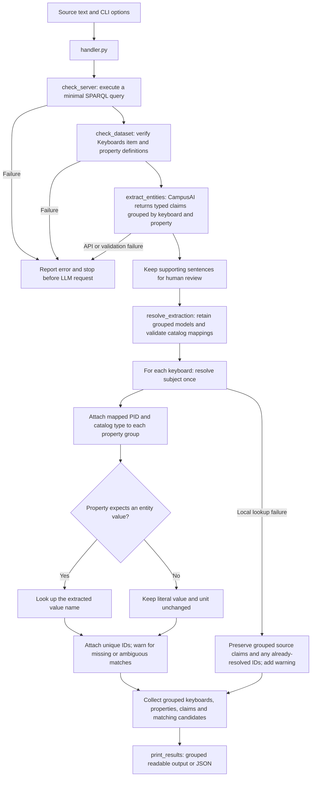
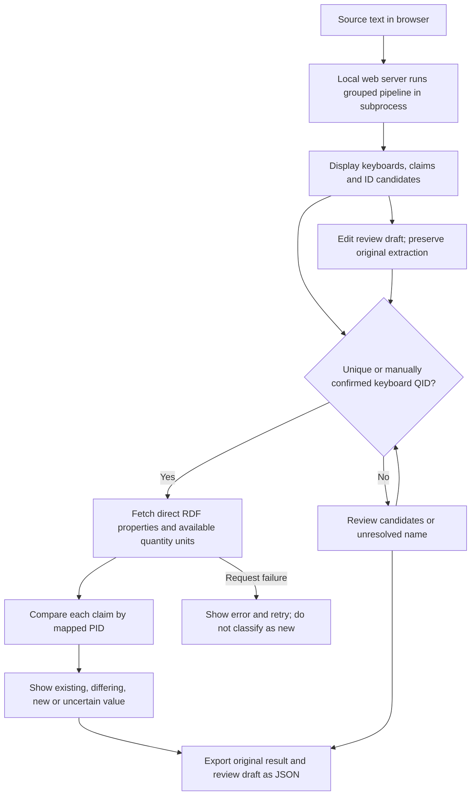

# Current Anywikia workflow

Run `python tests/start_qlever.py` before `python handler.py "Source text"`.
The diagram describes implemented behavior, not the future population workflow.

The local graph supplies matching IDs, not fact values. Supporting sentences are not checked for exact wording
or semantic support. The CLI does not compare existing values or modify RDF. The website adds the
read-only comparison and draft-review workflow below. The two server checks are in
`functions/qlever_checks.py`; every step module can also be executed independently.

The raw extraction and resolved output are separate typed grouped models.
The handler never calls to_claims. Exact case-insensitive label/alias retrieval
is retained; fuzzy similarity remains unimplemented. Browser comparison does not
write, replace, or approve RDF statements.

## Website review workflow

Start `python web_app.py` and open http://localhost:8000 after starting QLever.

Entity values compare resolved QIDs, including IDs found through aliases. Numeric
comparisons require compatible recognized units; conversion, qualifiers, ranks,
and property cardinality are not handled. Supporting context is model-provided
and remains unverified. Manual match confirmation and the add-entity demo affect
only the browser draft. Persistent approval, replacement, creation, and RDF writes
remain future work.
